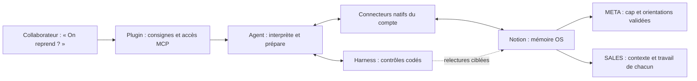

# VERTIGO - de la prospection dispersée à l’assistant d’équipe

**Revue technique privée · 9 novembre 2026.**
Tout se lit ici, sans installer de plugin, connecter Notion ou fournir une clé.

## Le problème rencontré

Je développais les sites web des client de l'agent Vertigo. Je disposais de mon propre espace de travail sur Notion et structurait le knowledge par projet (client, audit site web, remontées des informations, structuration de la doc technique, priorisation, validation, état d'avancement, livraison). 

En travaillant avec les commerciaux, j’ai constaté un autre problème : ils pouvaient se marcher dessus dans la
prospection. Qui suivait le prospect ? Quelle avait été la dernière action ?
Quelles consignes étaient encore valables ? Le contexte restait dispersé dans
les outils et les conversations.

La construction a suivi ce besoin : **conserver le contexte dans Notion → contrôler
les enregistrements → guider l’agent avec des compétences → organiser les rôles
META/SALES → rendre ce parcours accessible dans le chat habituel.**
Ces couches expliquent les choix ; ce n’est pas une chronologie datée de chaque commit.

**OS** : organisation de données, règles et mémoire dans Notion.
**Plugin** : compétences et connexion aux contrôles, pas un modèle entraîné.
**Agent** : interprétation, priorisation et utilisation des outils natifs.
**Harness** : serveur MCP avec identité, périmètres, protocoles et relectures vérifiées.
MCP est le protocole qui permet à l’agent d’appeler les outils du serveur.

## Lecture en cinq minutes

1. [Architecture et séparation des responsabilités](docs/ARCHITECTURE.md).
2. [Trois parcours concrets, de la demande aux preuves](docs/PARCOURS.md).
3. [Ce qui est prouvé, déclaré ou encore inconnu](docs/STATE-OF-EVIDENCE.md).

Pour aller jusqu’aux sources : [carte du code](docs/CODE-MAP.md),
[contrats MCP](docs/MCP-CONTRACTS.md), [schémas Notion](notion/README.md),
[choix techniques et limites](docs/DECISIONS-AND-LIMITS.md),
[compétences](skills/README.md), [preuves anonymisées](evidence/README.md),
[vérifications du dossier](verification/README.md).

La [revue Codex indépendante](verification/independent-review.md) approuve ce
dossier de lecture. Le [rapport de tests](verification/RESULTS.md) expose aussi
les trois attentes de l’ancien dépôt qui restent en échec dans cette copie.

## Le Daily GO, résultat concret de cette construction

À « On reprend ? », la méthode demande de relire le cap applicable, les règles et
le travail accessible, puis de proposer une priorité expliquée **avec un travail
préparé**. Exemple fictif : fiche client et trame prêtes, créneau laissé au choix
humain. Le modèle fait cette analyse ; le harness ne calcule pas un score universel.
Le propriétaire rapporte avoir vu ce parcours fonctionner. Cela ne remplace pas
une trace indépendante de chaque reprise dans chaque compte.

## Comment lire le statut du produit

| Ensemble | Statut dans ce dossier |
|---|---|
| Circuit hybride META/SALES natif | Sources présentes et reçus opérateur historiques, portée détaillée par preuve |
| Noyau transactionnel à cinq outils | Candidat distinct ; présence dans le code ≠ adoption par l’équipe |
| Ancien parcours à six outils | Historique, conservé pour comprendre la construction |
| Content OS, DEV OS, fabrique générique d’OS | Perspectives, pas capacités certifiées ici |
| Génération de propositions | Dépôt externe distinct ; l’ancienne commande est archivée |

**Cette copie n’est pas une nouvelle version de production.** Elle comprend les
modifications locales pertinentes, y compris des fichiers non committés dans le
dépôt source. La révision actuellement servie et les versions privées installées
n’ont pas été revalidées pour cette revue. Voir le
[manifeste de provenance](provenance/source-manifest.json).

## Ce qu'on peut évaluer :

- La séparation entre consigne au modèle, contrôle déterministe et validation humaine.
- Le chemin d’une orientation jusqu’à son reçu, sans écraser les règles locales.
- La portée des schémas, la reprise, l’idempotence et les modes d’échec.
- Les tests et leurs résultats, sans assimiler test opérateur et usage client.
- Les limites de visibilité : ni interception des outils privés, ni surveillance permanente.

Mon rôle : cadrage du besoin, conception du workflow et de ses contrats,
orchestration de l’implémentation assistée par IA, tests et accompagnement de l’équipe.
Temps gagné, satisfaction et ROI chiffré restent non établis par ce dossier.

Code et dépendances sont fournis pour audit. Les secrets, configurations réelles,
données clients et conversations privées sont exclus. [Conditions et dépendances](THIRD_PARTY_NOTICES.md).
