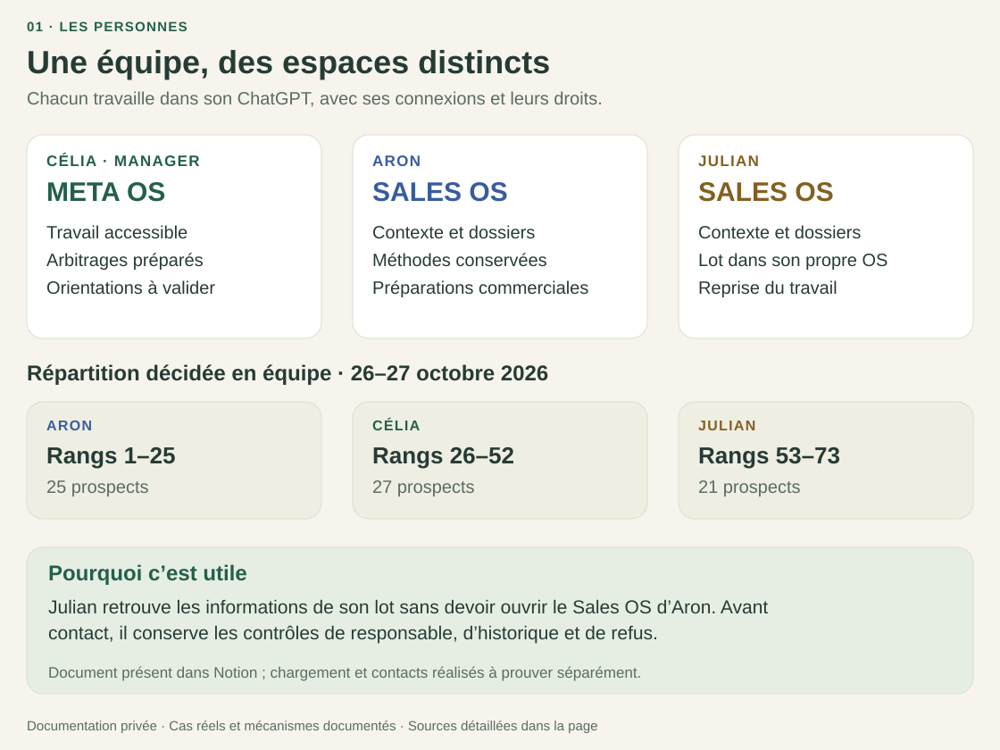
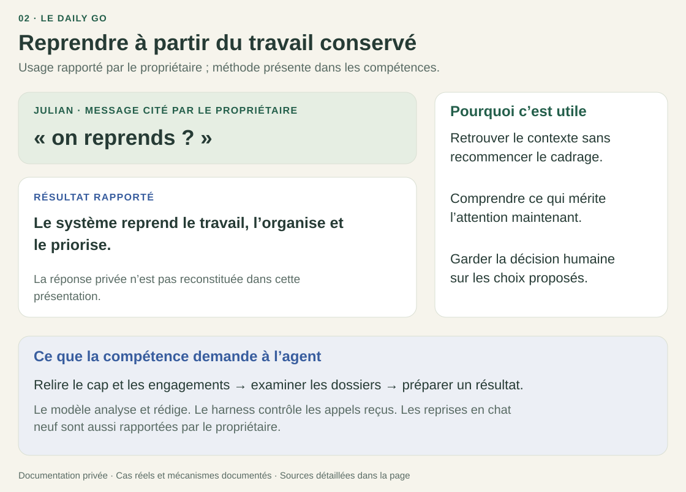
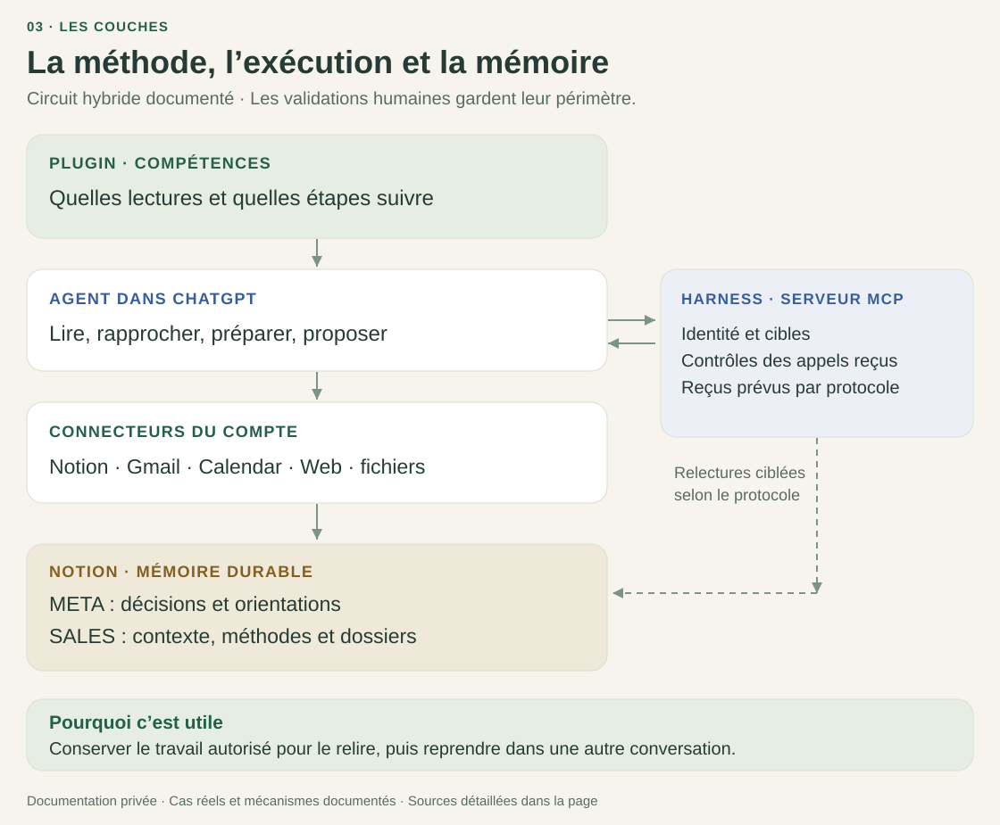

# VERTIGO - de la prospection dispersée à l’assistant d’équipe

**Revue technique privée · 9 novembre 2026.**
Tout se lit ici, sans installer de plugin, connecter Notion ou fournir une clé.

**Célia pilote depuis le META OS. Aron et Julian travaillent dans leurs SALES OS.**
Après la configuration du plugin et des connexions, chacun utilise son propre
ChatGPT : reprendre un dossier, préparer un message ou organiser la journée.
**L’équipe ne code pas.**

**Le parcours quotidien utilise leurs abonnements existants.** Le modèle travaille
dans ChatGPT ; le harness n’appelle pas d’API de modèle payante en supplément.
Les quotas et les accès des comptes restent applicables. Les abonnements aux
outils, l’hébergement du serveur et sa maintenance restent des coûts à distinguer.

## Célia manager : coordonner le travail de l’équipe

| Cas réel | Résultat disponible | Pourquoi c’est utile |
|---|---|---|
| **Répartir la prospection.** L’équipe décide des lots et le propriétaire transmet la répartition. | L’orientation de Julian, version 2, porte les rangs **53 à 73**, soit **21 prospects**, pour les 26–27 octobre. Aron a les rangs 1–25, Célia les rangs 26–52. | Julian retrouve son lot dans son OS sans devoir ouvrir celui d’Aron. L’équipe peut vérifier le périmètre décidé avant une prise de contact. |
| **Conserver les contrôles existants.** L’orientation demande de vérifier responsable, historique, doublons et refus. | Le document contient le lot et ses conditions ; il conserve les suivis, règles et autorisations locales. | La répartition ne remplace pas les contrôles et ne réattribue pas une fiche à l’aveugle. |

**Source :** [orientation réellement consultée dans Notion](evidence/07-notion-operational-artifacts.json).
Célia est la manager présentée ici et figure aussi dans la répartition commerciale
historique. La décision vient de l’équipe ; les pièces gardent leurs auteurs et
ne lui attribuent pas les publications de l’opérateur. La présence du document
ne prouve ni sa consommation dans le chat ni les contacts réalisés.

## Le Daily GO : reprendre et recevoir une priorité expliquée

| Demande et résultat | Pourquoi c’est utile |
|---|---|
| Le propriétaire rapporte avoir vu Julian demander **« on reprends ? »**, puis recevoir une organisation et une priorisation du travail. Il rapporte aussi les reprises en chat neuf des collaborateurs. | Reprendre sans redonner tout le contexte ni reconstituer l’historique du dossier. |
| La compétence demande de relire le cap applicable, les engagements, les dossiers et les méthodes, puis de **préparer un résultat exploitable**. | Recevoir une aide liée au travail en cours, avec une raison pour la priorité proposée. |

Le modèle analyse et rédige ; l’utilisateur garde les décisions et engagements
qui lui appartiennent. Le harness contrôle les appels reçus. Le Daily GO ne
lance pas un travail en arrière-plan et ne calcule pas de quotas inventés.

**Appuis :** [usage rapporté par le propriétaire](evidence/06-owner-reported-daily-go.json),
[complément d’usage](evidence/08-owner-reported-operational-usage.json),
[compétence Daily GO](skills/pilot-snapshot/vertigo-adaptive-coach/SKILL.md).
Le récit du propriétaire décrit l’usage observé ; ce dépôt ne contient pas la
réponse privée de Julian ni une nouvelle trace indépendante de cette reprise.

## Les autres résultats concrets

| Cas réel | Résultat visible dans les sources | Pourquoi c’est utile |
|---|---|---|
| **Aron fait évoluer sa méthode.** | Trois pages du 20 octobre sont présentes et liées depuis son playbook : **audit UX/SEO et contenus existants**, **contrôle du français**, **carrousel narratif personnalisé**. Le propriétaire rapporte qu’Aron les a ajoutées via son agent. | Conserver la manière de travailler dans Notion pour que l’agent puisse la retrouver, sans recopier les consignes à chaque demande. La relecture de l’email entier permet aussi de repérer les erreurs après personnalisation. |
| **Aron précise le discours commercial.** | La référence du **4 novembre**, liée depuis son playbook, contient le pitch, une trame de premier email, une relance et les réponses aux objections. La page indique une demande et une validation par Aron. | Préparer les messages avec le positionnement de l’entreprise et répondre à une objection avec un rôle précis pour Vertigo. |
| **Une préparation en série échoue.** | Après **« je veux mes 150 »**, le retour transmis par le propriétaire distingue la création non confirmée du dernier total fiable. Un autre extrait partagé montre une erreur de lecture CSV, `ServiceUnavailableError`. | Savoir ce qui reste à faire et conserver les résultats fiables, sans prendre un volume demandé pour un volume réalisé. |
| **Une réparation est relue.** | Un reçu historique rapporte **6 mutations vérifiées sur 6**, avec les erreurs antérieures conservées et les règles d’autorité inchangées. L’état reste **OPEN / LEARN**. | Vérifier la réparation ciblée sans annoncer la validation de tout le parcours métier. |

Un extrait du positionnement enregistré rend le résultat concret :

> « Nous transformons vos photos et vidéos existantes en expériences web qui se révèlent au défilement. »

Et pour répondre à un prospect qui a déjà une agence :

> « Votre agence peut continuer à gérer votre site. Nous pouvons concevoir la séquence, préparer les médias et travailler avec elle sur son intégration, après vérification des possibilités techniques. »

**Preuves :** [méthodes et positionnement Notion](evidence/07-notion-operational-artifacts.json),
[usages et incidents transmis par le propriétaire](evidence/08-owner-reported-operational-usage.json),
[réparation relue](evidence/03-admin-recovery.json).
Les méthodes sont présentes dans les documents consultés ; leur chargement à
chaque prompt exige sa propre preuve. Les [sondes CSV sélectionnées](evidence/04-csv-reporting.json)
ne démontrent pas la remontée automatique de l’incident depuis le compte d’Aron.

Ces cas viennent d’échanges réels et de documents consultés le **9 novembre 2026**.
Les instantanés Notion retournés portent des dates du 16 octobre au 6 novembre.
Les extraits retirent coordonnées, identifiants et données clients ; ils ne
reconstituent aucune réponse privée. Le [détail des cas](docs/UTILISER-VERTIGO.md)
permet de poursuivre la lecture, source par source.

## Le système en un coup d’œil

| Élément | Son rôle dans le travail quotidien |
|---|---|
| **META OS** | Le manager consulte le contexte de l’entreprise et prépare les orientations destinées à l’équipe. |
| **SALES OS** | Chaque commercial retrouve ses dossiers, son contexte et ses règles. |
| **PLUGIN** | Il apporte à l’agent les compétences et les étapes à suivre. |
| **HARNESS** | Le serveur applique ses contrôles codés aux appels qu’il reçoit. |
| **CONNEXIONS** | L’agent utilise les outils du compte, avec leurs droits et validations. |
| **PERSISTANCE** | L’agent fait enregistrer le travail autorisé dans Notion, puis le relit. Cette mémoire permet de reprendre dans une autre conversation. |

La conversation sert à demander et décider. Notion conserve les enregistrements.
Le harness vérifie les champs et protocoles qu’il prend en charge ; il ne voit pas
tous les gestes réalisés dans les outils natifs.

## Le problème rencontré

Je développais les sites web des client de l'agence web Vertigo. Je disposais de mon propre espace de travail sur Notion et structurait le knowledge par projet (client, audit site web, remontées des informations, structuration de la doc technique, priorisation, validation, état d'avancement, livraison, maintenance, etc). 

En travaillant avec les founders, j’ai constaté un autre problème : ils pouvaient se marcher dessus dans la
prospection. Qui suivait le prospect ? Quelle avait été la dernière action ?
Quelles consignes étaient encore valables ? Le contexte restait dispersé dans
leurs outils et leurs conversations sur ChatGPT.

La construction a suivi ce besoin : **conserver le contexte dans Notion → contrôler
les enregistrements → guider leurs propres agents via ChatGPT avec des compétences → organiser les rôles
META (admin) /SALES (ops) → rendre ce parcours accessible dans le chat habituel.**
Ces couches expliquent les choix ; ce n’est pas une chronologie datée de chaque commit.

**OS** : organisation de données, règles et mémoire dans Notion.
**Plugin** : compétences et connexion aux contrôles, pas un modèle entraîné.
**Agent** : interprétation, priorisation et utilisation des outils natifs.
**Harness** : serveur MCP avec identité, périmètres, protocoles et relectures vérifiées.
MCP est le protocole qui permet à l’agent d’appeler les outils du serveur.

## Lecture en cinq minutes

1. [L’équipe au travail](#célia-manager--coordonner-le-travail-de-léquipe), [Daily GO](#le-daily-go--reprendre-et-recevoir-une-priorité-expliquée) et [résultats](#les-autres-résultats-concrets), sur cette page.
2. [Architecture et séparation des responsabilités](docs/ARCHITECTURE.md).
3. [Trois parcours concrets, de la demande aux preuves](docs/PARCOURS.md).
4. [Ce qui est prouvé, déclaré ou encore inconnu](docs/STATE-OF-EVIDENCE.md).

Pour aller jusqu’aux sources : [carte du code](docs/CODE-MAP.md),
[contrats MCP](docs/MCP-CONTRACTS.md), [schémas Notion](notion/README.md),
[choix techniques et limites](docs/DECISIONS-AND-LIMITS.md),
[compétences](skills/README.md), [preuves anonymisées](evidence/README.md),
[vérifications du dossier](verification/README.md).

La [revue Codex indépendante](verification/independent-review.md) approuve ce
dossier de lecture. Le [rapport de tests](verification/RESULTS.md) expose aussi
les trois attentes de l’ancien dépôt qui restent en échec dans cette copie.

## Comment lire le statut du produit

| Ensemble | Statut dans ce dossier |
|---|---|
| Circuit hybride META/SALES natif | Sources présentes et reçus opérateur historiques, portée détaillée par preuve |
| Noyau transactionnel à cinq outils | Candidat distinct ; présence dans le code ≠ adoption par l’équipe |
| Ancien parcours à six outils | Historique, conservé pour comprendre la construction |
| Content OS, DEV OS, fabrique générique d’OS | Perspectives, pas capacités certifiées ici |
| Génération de propositions | Dépôt externe distinct ; l’ancienne commande est archivée |

**Cette copie n’est pas une nouvelle version de production.** Elle comprend les
modifications locales pertinentes, y compris des fichiers non committés dans le
dépôt source. La révision actuellement servie et les versions privées installées
n’ont pas été revalidées pour cette revue. Voir le
[manifeste de provenance](provenance/source-manifest.json).

## Ce qu'on peut évaluer :

- La séparation entre consigne au modèle, contrôle déterministe et validation humaine.
- Le chemin d’une orientation jusqu’à son reçu, sans écraser les règles locales.
- La portée des schémas, la reprise, l’idempotence et les modes d’échec.
- Les tests et leurs résultats, sans assimiler test opérateur et usage client.
- Les limites de visibilité : ni interception des outils privés, ni surveillance permanente.

Mon rôle : cadrage du besoin, conception du workflow et de ses contrats,
orchestration de l’implémentation assistée par IA, tests et accompagnement de l’équipe.
Temps gagné, satisfaction et ROI chiffré restent non établis par ce dossier.

Code et dépendances sont fournis pour audit. Les secrets, configurations réelles,
données clients et conversations privées sont exclus. [Conditions et dépendances](THIRD_PARTY_NOTICES.md).
