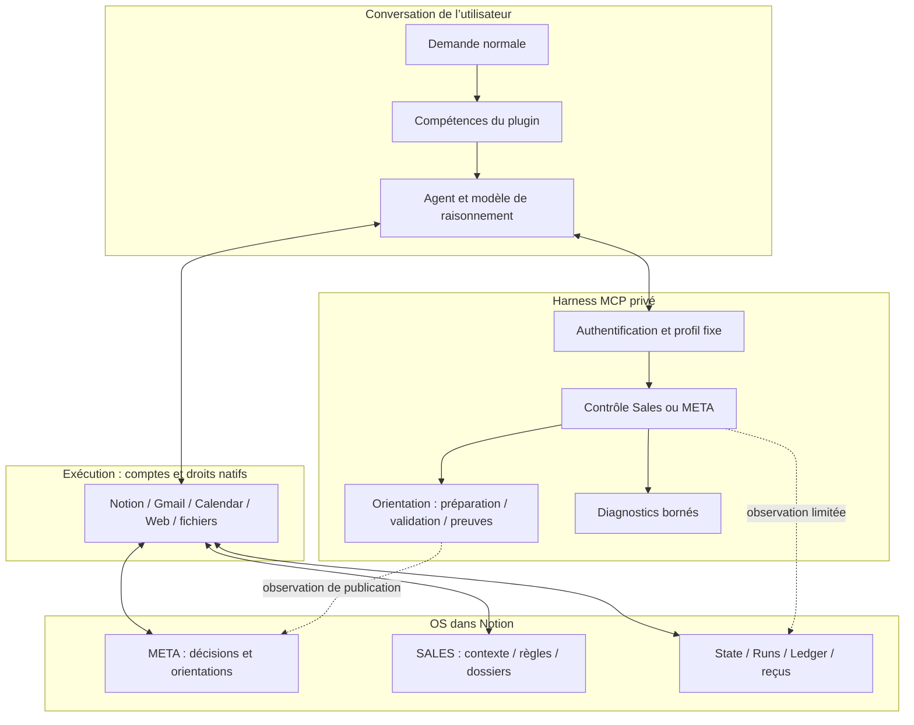

# Quatre responsabilités distinctes

Le schéma montre le circuit hybride documenté. L’API et les écritures du noyau
candidat sont décrites à part ; elles ne doivent pas être projetées sur ce circuit.

| Couche | Responsabilité | Limite |
|---|---|---|
| OS | Mémoire durable et organisation des faits, méthodes et états | Une page n’est pas une permission ni une preuve d’effet externe |
| Plugin | Faire reconnaître le besoin et prescrire les lectures et étapes | Une compétence n’est pas un hook déterministe à chaque message |
| Agent + connecteurs | Lire, interpréter, préparer et exécuter les opérations autorisées | Le modèle peut manquer un appel ; les outils gardent leurs propres droits |
| Harness | Authentifier, borner les cibles, valider les protocoles et vérifier les champs pris en charge | Il n’intercepte pas tous les appels natifs, mails ou fichiers privés |

## META et SALES

META est le cockpit de pilotage : cap, décisions et orientations adressées aux
destinataires configurés. SALES est le contexte de travail de chaque commercial.
Le rôle ne provient pas d’un prénom dans le prompt : le serveur résout un profil
authentifié. Notion applique ses propres listes de droits d’accès (ACL), et les
connecteurs appliquent leurs autorisations. Le serveur n’accorde pas ces accès à leur place.

## Ce qui évolue sans reconstruire le plugin

Une préférence, un contexte ou une méthode peut évoluer dans le bon Notion ;
l’agent doit la relire réellement. La réponse serveur peut aussi offrir un protocole
technique compatible. Une méthode offerte ne prouve ni sa réception ni son application.
Nouveaux outils, authentification ou déclencheurs de compétence peuvent demander
une mise à jour du paquet. Les copies privées ne sont pas modifiables depuis
un autre compte par la seule existence d’un ZIP.

## Composants livrés dans les sources

- Serveur TypeScript, SDK MCP, validation Zod et stockage technique mémoire/PostgreSQL.
- Adaptateurs Notion versionnés, code d’observation et noyau transactionnel candidat.
- Compétences, manifestes, scripts de préparation de paquets et tests.
- Références Docker/Caddy/PostgreSQL et migrations : documentation d’exploitation uniquement.

Les messages Gmail ne transitent pas automatiquement par le harness. Une
relecture Notion prouve l’artefact concerné, pas qu’un mail a été envoyé.
La [carte du code](CODE-MAP.md) relie ces affirmations aux implémentations.
