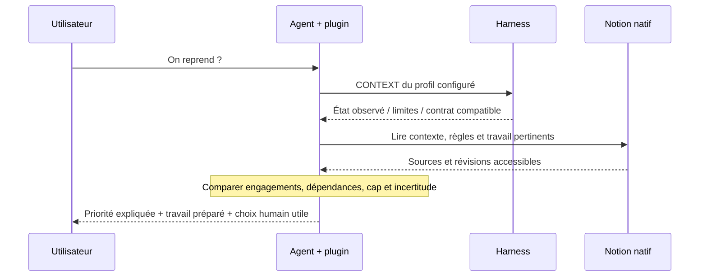
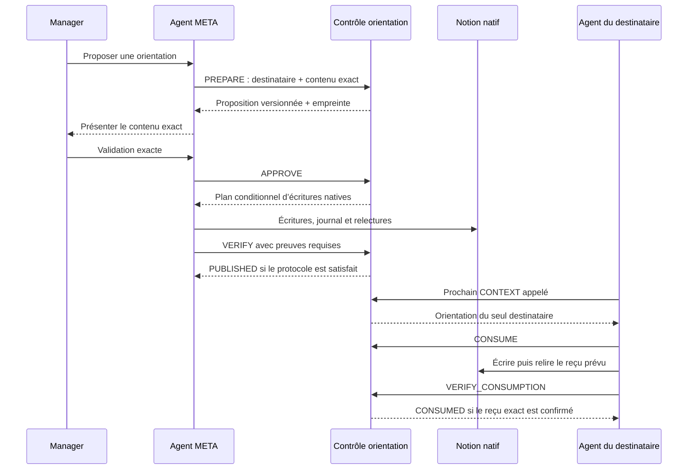

# Trois demandes suivies de bout en bout

Pour voir les demandes et les résultats côté équipe, commencer par
[les cas réels illustrés](UTILISER-VERTIGO.md).

Les étapes ci-dessous décrivent le mécanisme. Les exemples métier sont fictifs.
Le niveau de preuve de l’usage réel reste dans [l’état des preuves](STATE-OF-EVIDENCE.md).

## 1. « On reprend ? » : retrouver le travail et préparer le Daily GO

**Entrées** : profil authentifié, cap applicable, règles, State/Run et dossiers
pertinents ; temps disponible seulement s’il est déclaré. Pas de lecture générale
de la messagerie. Le coach demande un résultat préparé, pas une liste de conseils.

**Modèle** : sélection du contenu pertinent, hiérarchisation et rédaction.
**Code** : admission, schémas, observation bornée et diagnostics des appels reçus.
**Humain** : arbitrage des choix et validations applicables. Une proposition ne crée
pas automatiquement une tâche, un engagement ou un droit.

**Persistance** : uniquement si l’opération est autorisée et écrite puis
relue. Une réponse dans le chat n’est pas une écriture Notion. Aucune planification
d’arrière-plan n’est ajoutée par le Daily GO.

**Échec** : source inaccessible ou contexte incomplet → limite explicite et
préparation indépendante autorisée seulement ; aucune mémoire ou priorité inventée.

Sources : [bootstrap Sales](../packages/native-sales-bootstrap/SKILL.bootstrap.md),
[orchestration](../skills/pilot-snapshot/vertigo-native-orchestrator/SKILL.md),
[coach](../skills/pilot-snapshot/vertigo-adaptive-coach/SKILL.md),
[observation Sales](../packages/harness/src/verify/nativeSalesControl.ts).

## 2. « Pour ce travail, applique désormais cette méthode »

1. L’agent relit les règles et le périmètre courant du bon OS.
2. Il distingue une préférence de travail d’un changement de droits ou de politique.
3. Si la modification est autorisée, il utilise le schéma et les liens de lecture
   existants ; les connecteurs natifs exécutent l’écriture selon le protocole applicable.
4. Il relit l’enregistrement et qualifie la preuve. Le vérificateur limité ne doit
   pas être présenté comme une certification de toute méthode ou transaction.
5. À la demande suivante, la méthode devient utilisable si elle appartient au
   parcours relu. Une page isolée non reliée n’est pas garantie d’être trouvée.

**Sans code** concerne le contenu des méthodes que les compétences existantes savent
déjà découvrir. Ajouter un nouveau tool ou une nouvelle permission est un autre chantier.
En cas de contradiction, le modèle doit respecter les règles et validations applicables,
nommer l’ambiguïté et ne pas inventer une priorité universelle entre documents.

La structure d’exemple est dans [le dossier synthétique](../examples/work-dossier.json).
Il n’est pas un import Notion, une migration, ni une méthode installée.

## 3. META → collaborateur : publier une orientation et vérifier sa réception

Le domaine de journalisation des orientations est distinct des contrôles Sales
existants. Les dépendances sont vérifiées avant les cibles aval et le pointeur
courant est mis à jour en dernier. Les règles locales et l’historique sont préservés.

**Trois états à séparer** : publication, reçu de consommation, résultat métier.
L’approbation est attestée par la session propriétaire ; ce n’est pas un service
indépendant prouvant un clic humain. L’agent destinataire ne peut pas être réveillé
dans son chat privé. Une observation opérateur ne devient pas une preuve de son compte.

Sources : [contrôleur](../packages/harness/src/verify/realDirectionControl.ts),
[preuves de publication](../packages/harness/src/verify/realDirectionPublication.ts),
[tests de coexistence et réception](../packages/harness/test/unit/pv-real-direction-control.test.ts).
