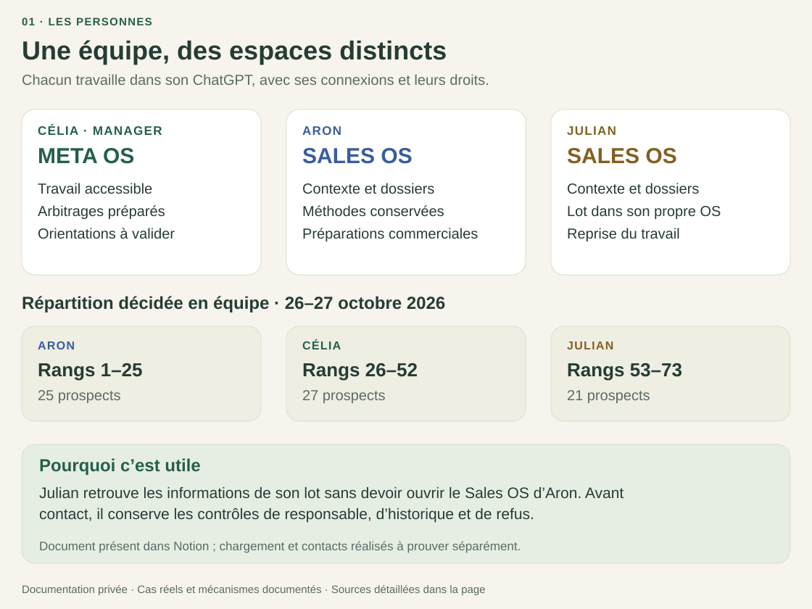
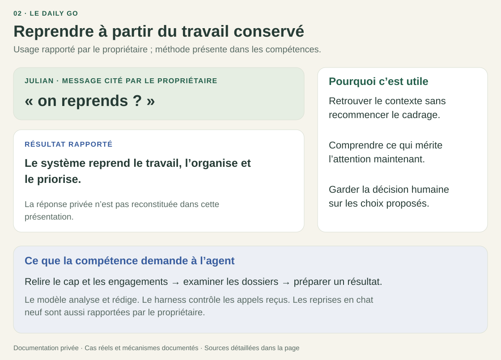
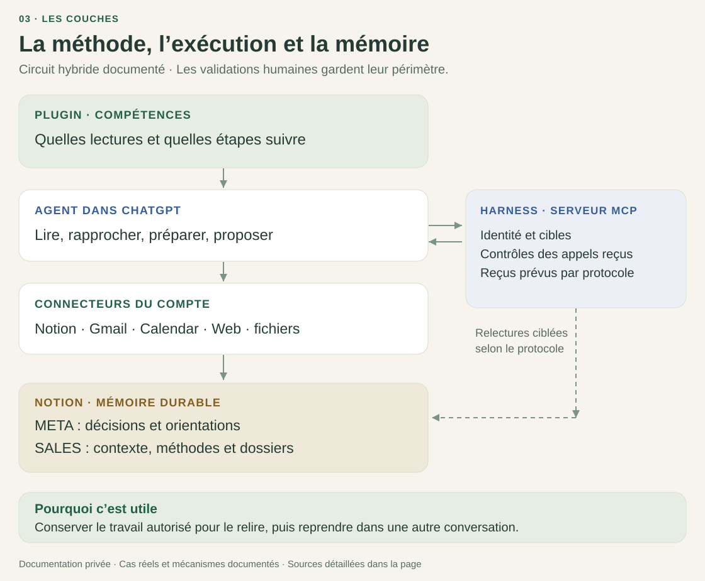

# VERTIGO au travail : des cas réels

**Célia, manager, pilote depuis le META OS. Aron et Julian travaillent dans leurs SALES OS.**
Chacun utilise son propre ChatGPT et ses connexions. L’équipe ne code pas : elle
reprend un dossier, demande une préparation ou précise sa méthode en conversation.

Le parcours quotidien utilise leurs abonnements existants, sans API de modèle
payante supplémentaire appelée par le harness. Les quotas des comptes,
l’hébergement du serveur et la maintenance restent des coûts à distinguer.

Cette page s’appuie sur les échanges transmis par le propriétaire, les pièces
historiques du dépôt et dix pages Notion consultées le **9 novembre 2026**. Les
vues Notion retournées portent leurs propres dates d’instantané, du 16 octobre
au 6 novembre. Les encadrés présentent des extraits ou des résumés de ces sources,
sans reconstituer les réponses privées des agents. Les prénoms sont conservés à
la demande du propriétaire ; les coordonnées, identifiants et dossiers clients restent exclus.

[Les personnes](#1-qui-fait-quoi) · [Les cas réels](#2-ce-que-léquipe-a-demandé-et-obtenu) ·
[Les couches](#3-comment-les-couches-interviennent) · [Mode d’emploi](#4-partir-dun-besoin-concret)

## 1. Qui fait quoi

| Personne et espace | Travail concerné | Pourquoi c’est utile |
|---|---|---|
| **Célia, manager META** | Consulter le travail accessible, arbitrer et préparer une orientation pour l’équipe. | Donner un cap avec son contexte, puis consulter les informations partagées. |
| **Aron, SALES OS** | Préparer sa prospection, retrouver ses méthodes et les faire évoluer dans Notion. | Réutiliser le savoir commercial et ses préférences sans les recopier dans chaque demande. |
| **Julian, SALES OS** | Reprendre son travail et retrouver les informations de son lot dans son propre OS. | Avancer sur ses dossiers sans dépendre d’un accès à l’OS d’Aron. |
| **Opérateur du système** | Raccorder les profils et connexions, maintenir le serveur et diagnostiquer les incidents. | Laisser l’équipe travailler dans le chat tout en gardant un responsable technique. |

Célia est présentée comme manager à la demande du propriétaire. Les pièces
historiques conservent leurs auteurs et leurs destinataires ; elles ne lui
attribuent pas les publications réalisées par l’opérateur. Le serveur résout
le profil authentifié. Notion et les autres outils appliquent leurs propres droits.
Le manager ne reçoit pas les conversations privées par la seule présence du plugin.

**Sources :** [architecture des accès](ARCHITECTURE.md),
[authentification](../packages/harness/src/server/http.ts),
[lecture Notion ciblée, avec dates et portée](../evidence/07-notion-operational-artifacts.json).
Cette lecture documentaire ne revalide pas les droits actuels de chaque compte.

## 2. Ce que l’équipe a demandé et obtenu

### A. Se répartir les prospects sans ouvrir les OS des autres

Le propriétaire a transmis la répartition décidée par l’équipe :

> « Aron tu peux prendre les 25 premiers, moi à partir du 26ieme-52 et Julian line 53-73 »

| Résultat enregistré dans l’orientation de Julian | Pourquoi c’est utile |
|---|---|
| **Aron : rangs 1 à 25**, soit 25 prospects. **Célia : rangs 26 à 52**, soit 27 prospects. **Julian : rangs 53 à 73**, soit 21 prospects. Les rangs 74 à 100 restent hors de cette répartition. | Chacun peut retrouver le périmètre décidé. La répartition évite de demander à Julian un accès au Sales OS d’Aron pour récupérer son lot. |
| L’orientation de Julian contient les informations de ses 21 prospects. Elle demande de contrôler le responsable existant, l’historique accessible, les doublons et les refus avant toute prise de contact. | L’équipe conserve les suivis existants. Une répartition de travail ne remplace pas les contrôles commerciaux. |

**Ce qui est relu :** document destinataire, version 2, horizon des 26–27 octobre,
sous la racine Sales de Julian. La décision vient de l’équipe, le propriétaire
l’a transmise. Célia figure aussi dans la répartition commerciale historique.
Cette page conserve ce fait tout en la présentant dans son rôle de manager.

**Ce que ce document ne prouve pas :** que chaque prospect a été contacté, que
l’agent a consommé l’orientation dans son chat, ou qu’un nouveau responsable a
été écrit sur une fiche existante.

**Preuves :** [extrait anonymisé de l’orientation réelle](../evidence/07-notion-operational-artifacts.json),
[publication META historique](../evidence/01-direction-publication.json),
[limite du reçu destinataire sélectionné](../evidence/02-direction-reception-gap.json).
Le [parcours technique](PARCOURS.md#3-meta--collaborateur--publier-une-orientation-et-vérifier-sa-réception)
explique la validation, la publication et la consommation séparées.

### B. Reprendre avec le Daily GO

| Usage rapporté et méthode disponible | Pourquoi c’est utile |
|---|---|
| Le propriétaire rapporte avoir vu Julian demander **« on reprends ? »**, puis recevoir une organisation et une priorisation du travail. Il rapporte aussi les reprises en chat neuf des collaborateurs. | Le collaborateur peut reprendre sans redonner tout le contexte. |
| La compétence demande de retrouver le cap applicable, les engagements, les dossiers, les méthodes locales et le temps déclaré, puis de préparer un résultat exploitable. | L’utilisateur reçoit une aide liée à son travail, avec une raison pour la priorité proposée. |

L’agent analyse et rédige. Le harness contrôle les appels et les champs de ses
protocoles ; il ne calcule pas un classement universel des tâches. Les choix et
engagements proposés restent à accepter. Le Daily GO ne lance pas de travail
hors du chat et ne transforme pas un objectif trimestriel en quotas inventés.

**Appuis :** [témoignage de reprise et priorisation](../evidence/06-owner-reported-daily-go.json),
[complément d’usage fourni dans les échanges](../evidence/08-owner-reported-operational-usage.json),
[coach](../skills/pilot-snapshot/vertigo-adaptive-coach/SKILL.md),
[amorce Sales](../packages/native-sales-bootstrap/SKILL.bootstrap.md).
L’usage est rapporté par le propriétaire ; ce dossier ne contient pas la réponse
privée de Julian ni une nouvelle trace indépendante de cette reprise.

### C. Aron précise lui-même la manière de travailler

Trois pages datées du 20 octobre sont présentes dans le dossier **Operations &
Playbooks** d’Aron. Le propriétaire rapporte qu’Aron a ajouté ses compétences
via son agent, sans intervention de sa part.

| Contenu réellement conservé dans Notion | Pourquoi c’est utile |
|---|---|
| **Audit UX/SEO et contenus existants.** La méthode relie l’analyse du site à l’inventaire des photos, vidéos et autres contenus. Elle interdit de présenter un audit non réalisé comme terminé. | Préparer une approche liée à ce que l’entreprise peut montrer, avec des faits à vérifier. |
| **Contrôle linguistique français.** La méthode exige la relecture de l’email entier après personnalisation, puis de l’objet, du texte et du HTML rendu. | Repérer les phrases incorrectes qu’un assemblage de variables peut produire. |
| **Carrousel narratif personnalisé.** Chaque bloc doit expliquer l’idée proposée, les contenus disponibles et l’intérêt commercial recherché, selon l’activité du prospect. | Éviter de proposer le même récit à un hôtel, un industriel et un lieu événementiel. |

**Résultat visible :** ces méthodes existent comme pages de travail, avec des
liens depuis Operations & Playbooks. La consultation confirme leur présence et
leurs références. L’attribution à l’action autonome d’Aron vient du témoignage
du propriétaire ; elle ne vient pas d’une capture indépendante de son chat.

L’agent retrouve une méthode si elle fait partie du parcours qu’il relit. Une
page isolée ne garantit pas sa découverte. Les règles historiques restent
historiques : cette présentation ne les réapplique pas et ne les met pas à jour.

**Preuves :** [extraits des trois pages et du parent](../evidence/07-notion-operational-artifacts.json),
[témoignage sur l’ajout par Aron](../evidence/08-owner-reported-operational-usage.json),
[mécanisme de modification et relecture](PARCOURS.md#2--pour-ce-travail-applique-désormais-cette-méthode-).

### D. Mettre à jour le discours commercial dans la mémoire de travail

Le dossier Operations & Playbooks d’Aron pointe vers une référence du **4 novembre**.
Cette page indique une intégration demandée directement par Aron et un
positionnement validé par lui.

| Extraits du document enregistré | Pourquoi c’est utile |
|---|---|
| **Phrase de référence :** « Nous transformons vos photos et vidéos existantes en expériences web qui se révèlent au défilement. » | Le collaborateur dispose d’une formulation commune, liée au savoir-faire de l’entreprise. |
| **Client déjà accompagné par une agence :** « Votre agence peut continuer à gérer votre site. Nous pouvons concevoir la séquence, préparer les médias et travailler avec elle sur son intégration, après vérification des possibilités techniques. » | Il peut répondre à une objection avec un rôle précis pour Vertigo et pour le prestataire existant. |
| Le document organise le message : observation réelle, scène proposée, bénéfice recherché, invitation à regarder la piste ensemble. Il contient aussi une trame de premier email et des réponses aux objections. | L’agent dispose d’une base pour préparer un message personnalisé. Le collaborateur peut examiner le texte avant de l’utiliser. |

La page précise que la mise à jour ne réécrit pas les emails historiques et ne
déclenche aucune campagne. Son parent la désigne comme référence pour les messages
commerciaux dans l’instantané retourné. La présence de la page ne prouve pas à
elle seule son chargement lors de chaque prompt suivant.

**Preuve :** [positionnement et référence dans le playbook, avec leurs dates](../evidence/07-notion-operational-artifacts.json).
**Mécanisme :** [lectures fraîches prescrites par l’amorce Sales](../packages/native-sales-bootstrap/SKILL.bootstrap.md).

### E. Voir un blocage réel, sans annoncer un travail non réalisé

Le propriétaire a transmis le prompt d’Aron **« je veux mes 150 »**, puis le
retour de son agent : création en série non confirmée et dernier total fiable
conservé. Dans un autre échange transmis, une lecture du CSV a retourné
`ServiceUnavailableError`.

| Résultat disponible | Pourquoi c’est utile |
|---|---|
| Le retour partagé distingue les candidats préparés, les brouillons confirmés et la création qui a échoué. | Aron peut savoir ce qui reste à faire sans prendre un volume demandé pour un volume réalisé. |
| L’amorce prévoit un rapport de début puis de fin d’étape. Une erreur de lecture locale/CSV relève de la lecture de fichier, pas d’une erreur Gmail inventée. | L’opérateur dispose d’un diagnostic exploitable lorsque l’agent le transmet. |

**Preuves :** [échanges rapportés par le propriétaire](../evidence/08-owner-reported-operational-usage.json),
[sondes opérateur du reporting CSV](../evidence/04-csv-reporting.json),
[contrôle des rapports](../packages/harness/src/verify/nativeSalesControl.ts).
La pièce de reporting sélectionnée n’observe pas de cycle client hors sondes.
Le blocage partagé et la capacité serveur existent ; la remontée automatique de
cet incident depuis son chat reste non prouvée par cette pièce.

### F. Confirmer un enregistrement après relecture

| Résultat du reçu historique de reprise administrative | Pourquoi c’est utile |
|---|---|
| Le reçu rapporte **6 mutations vérifiées sur 6**, avec les erreurs antérieures conservées et les règles d’autorité inchangées. L’état reste **OPEN / LEARN** ; aucun succès global de production n’est annoncé. | Distinguer une réparation enregistrée de la validation de tout le parcours métier. |

Cet événement concerne une réparation ciblée, pas la preuve d’une écriture
commerciale arbitraire. Le protocole conserve les succès et les références,
ajoute le journal requis, relit l’écriture puis met le pointeur courant à jour.

**Preuves :** [reçu anonymisé](../evidence/03-admin-recovery.json),
[structures et ordre de persistance](../notion/README.md#ordre-dune-écriture-et-de-la-reprise).
Le compte concerné reste anonymisé dans cette pièce.

## 3. Comment les couches interviennent

| Couche | Travail dans les cas ci-dessus | Pourquoi elle existe |
|---|---|---|
| **META OS** | Conserver les décisions et les orientations destinées aux personnes configurées. | Donner une référence au pilotage de Célia et de l’équipe. |
| **SALES OS** | Conserver le lot, les méthodes et le contexte du collaborateur. | Reprendre depuis la mémoire du bon espace. |
| **Plugin** | Prescrire les lectures et les étapes au travers des compétences. | Éviter de réécrire la méthode dans chaque prompt. |
| **Agent** | Rapprocher les sources, rédiger, préparer et proposer une priorité. | Faire le travail qui dépend de l’interprétation du dossier. |
| **Connecteurs** | Utiliser le compte Notion, Gmail ou agenda exposé pour l’action concernée. | Travailler avec les sources et autorisations de la personne. |
| **Harness** | Authentifier les appels, borner les cibles et vérifier les champs prévus. | Contrôler les opérations qui passent par lui et leurs preuves. |
| **Persistance** | Enregistrer l’opération autorisée et la relire selon le protocole. | Retrouver un état de travail dans une autre conversation. |
| **Humain** | Valider une orientation ou une action qui exige son accord. | Garder la décision distincte de la préparation et de l’effet obtenu. |

Le schéma décrit le circuit hybride documenté. Le [noyau transactionnel candidat](ARCHITECTURE.md)
reste distinct. Le harness n’intercepte pas tous les outils natifs et une compétence
ne garantit pas un appel à chaque message. Une relecture Notion confirme un
artefact ; la confirmation d’un envoi appartient à sa source compétente.

## 4. Partir d’un besoin concret

Les demandes citées plus haut viennent des échanges fournis. Les familles ci-dessous
expliquent où trouver la méthode ou la trace correspondante ; elles ne reconstituent
pas de nouvelles conversations.

<strong>Reprendre et choisir le travail utile</strong>

| Besoin | Ce que l’utilisateur doit retrouver | Pourquoi c’est utile | Source |
|---|---|---|---|
| Reprise dans la conversation | État accessible, travail restant et priorité expliquée. | Continuer sans refaire tout le cadrage. | [Usage rapporté](../evidence/06-owner-reported-daily-go.json). |
| Reprise dans un chat neuf | Contexte et informations conservées dans Notion. | Réduire la dépendance à la mémoire d’un fil. | [Témoignage](../evidence/08-owner-reported-operational-usage.json), [amorce](../packages/native-sales-bootstrap/SKILL.bootstrap.md). |
| Temps disponible ou priorité différente | Préparation utile, compromis et choix humain. | Adapter la proposition au travail et à la capacité déclarés. | [Coach](../skills/pilot-snapshot/vertigo-adaptive-coach/SKILL.md) : méthode, pas nouvelle preuve d’usage. |
| Rendez-vous ou relance à préparer | Contexte relu et texte ou fiche préparée. | Utiliser le dossier plutôt qu’un message générique. | [Méthodes réellement conservées](../evidence/07-notion-operational-artifacts.json) ; exécution d’un nouveau cas non testée ici. |

<strong>Coordonner le travail avec Célia</strong>

| Besoin | Résultat disponible ou méthode | Pourquoi c’est utile | Source |
|---|---|---|---|
| Répartition | Lots définis et document destinataire présent dans l’OS de Julian. | Éviter de lui imposer l’accès à l’OS d’un collègue. | [Orientation relue](../evidence/07-notion-operational-artifacts.json). |
| Orientation | Contenu exact, validation, publication et réception traitées séparément. | Savoir ce qui a été préparé, publié et reçu. | [Parcours](PARCOURS.md#3-meta--collaborateur--publier-une-orientation-et-vérifier-sa-réception), [pièces historiques](../evidence/README.md). |
| Priorités et revue | Lecture des dossiers, propositions d’arbitrage et couverture des sources. | Préparer les décisions de Célia avec les informations accessibles. | [Méthode META](../skills/pilot-snapshot/vertigo-native-orchestrator/references/business-resume.md) ; aucun bilan réel de Célia reconstitué. |
| Chevauchement sur un compte | Contrôle du responsable, de l’historique et des refus avant contact. | Préserver les suivis et les décisions déjà prises. | [Consignes du lot réel](../evidence/07-notion-operational-artifacts.json) ; détection automatique globale non démontrée. |

<strong>Faire évoluer le savoir et les méthodes</strong>

| Besoin | Résultat réel ou mécanisme | Pourquoi c’est utile | Source |
|---|---|---|---|
| Préciser une approche | Pages d’audit, de contrôle français et de narration conservées chez Aron. | Garder la méthode disponible pour les travaux suivants. | [Extraits Notion](../evidence/07-notion-operational-artifacts.json). |
| Mettre à jour le pitch | Référence du 4 novembre liée depuis le playbook. | Partager une formulation et les réponses aux objections. | [Positionnement relu](../evidence/07-notion-operational-artifacts.json). |
| Recharger une méthode | Lecture du contexte et des playbooks pertinents à chaque demande de travail. | Appliquer les informations que l’agent a réellement relues. | [Amorce](../packages/native-sales-bootstrap/SKILL.bootstrap.md) : consigne, pas interception déterministe. |
| Changer un outil, un droit ou le paquet | Configuration ou version technique à traiter par l’opérateur. | Séparer l’évolution du contenu d’un changement d’accès. | [Architecture des mises à jour](ARCHITECTURE.md#ce-qui-évolue-sans-reconstruire-le-plugin). |

<strong>Vérifier un résultat et reprendre après un incident</strong>

| Besoin | Résultat à distinguer | Pourquoi c’est utile | Source |
|---|---|---|---|
| Échec de fichier ou création non confirmée | Travail préparé, effet confirmé et échec rapporté. | Conserver le dernier résultat fiable. | [Cas transmis](../evidence/08-owner-reported-operational-usage.json). |
| Diagnostic serveur | Appel reçu, rapport d’agent et fenêtre couverte. | Chercher le blocage sans prétendre voir les outils privés. | [Reporting CSV](../evidence/04-csv-reporting.json), [observation bornée](../evidence/05-passive-activity.json). |
| Écriture non confirmée | État inconnu ou partiel, puis relecture ciblée avant reprise. | Éviter une confirmation prématurée ou un doublon. | [Protocole](../notion/README.md#ordre-dune-écriture-et-de-la-reprise). |
| Réparation | Mutations ciblées relues, historique et autorité préservés. | Reprendre sans effacer les réussites ni les erreurs passées. | [Reçu réel anonymisé](../evidence/03-admin-recovery.json). |
| Connexion absente ou droit refusé | Accès concerné arrêté ; préparations indépendantes autorisées conservées. | Limiter le blocage à son périmètre. | [Amorce](../packages/native-sales-bootstrap/SKILL.bootstrap.md), [droits](ARCHITECTURE.md). |

## 5. Retrouver la preuve derrière chaque résultat

| Niveau | Ce qu’on sait | Où le lire |
|---|---|---|
| **Usage rapporté** | Le propriétaire décrit un usage qu’il a vu ou un retour qu’il a reçu. | [Daily GO](../evidence/06-owner-reported-daily-go.json), [ajout de méthodes et incidents](../evidence/08-owner-reported-operational-usage.json). |
| **Artefact Notion consulté** | Le connecteur retourne le document et ses références dans un instantané daté. | [Répartition, méthodes et positionnement](../evidence/07-notion-operational-artifacts.json). |
| **Observation opérateur historique** | Un reçu rapporte une opération dans son périmètre. | [Publication](../evidence/01-direction-publication.json), [réparation](../evidence/03-admin-recovery.json), [sondes](../evidence/04-csv-reporting.json). |
| **Mécanisme présent** | Une compétence ou du code décrit les étapes attendues. | [Compétences](../skills/README.md), [carte du code](CODE-MAP.md), [tests et limites](../verification/RESULTS.md). |

Les documents publiés sont des dérivés : les identifiants privés et les coordonnées
ont été retirés. Les empreintes des sources identifient les textes consultés ;
elles ne signent pas les résumés transformés. Les déclarations, la présence d’un
document, son chargement par l’agent et le résultat métier ont chacun leur preuve.

La génération de propositions relève du dépôt dédié. Content OS et DEV OS restent
des perspectives dans cette revue. Temps gagné, satisfaction et ROI chiffré
restent à mesurer : [état des preuves](STATE-OF-EVIDENCE.md).

[Retour au dépôt](../README.md) · [Parcours techniques](PARCOURS.md) ·
[Carte du code](CODE-MAP.md) · [Index des preuves](../evidence/README.md)
