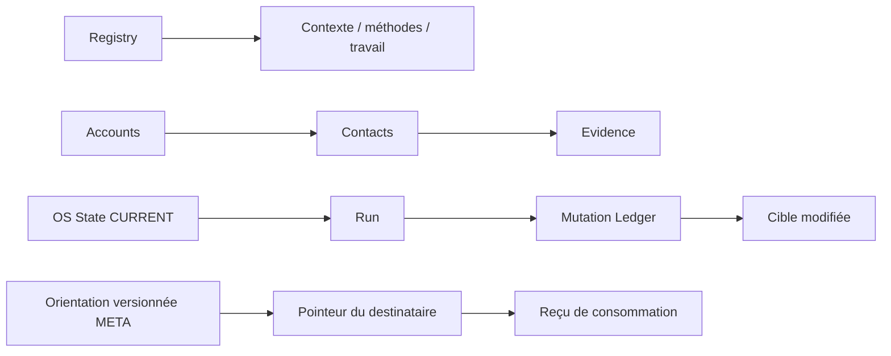

# Les OS dans Notion : schémas et granularité

**Une source Accounts a été relue le 9 novembre 2026, via le connecteur Notion.**
La lecture concerne sa configuration, pas ses lignes. Les 19 propriétés sont
exportées sans identifiants dans [le schéma observé](observed/accounts-schema.json).
Cette observation ne confirme pas les autres bases ni toutes les instances.

Les [grammaires extraites du code](derived/control-plane-grammars.json) décrivent
les versions implémentées : propriétés, types, options requises et ressources.
Leur existence ne prouve ni migration ni adoption d’une version.

| Objet | Granularité et rôle | Exemples de propriétés / types |
|---|---|---|
| Manifest / Registry | Instance courante et adresses logiques | Identité, versions, racine, statut et pointeurs selon version |
| Business Configuration | Un élément de contexte par ligne | Config Item:title, Category:select, State:select, Value:rich_text, Version:rich_text |
| Méthodes / Playbook / Daily GO | Corps de pages, parfois séquences | Texte et références de lecture ; pas un binaire installé |
| Authority Matrix | Une action et ses conditions | Action:title, Allowed In Mode:multi_select, Authority:select, Active:checkbox |
| OS State | Curseur CURRENT | Gate, état, blocage, prochaine action et Last Run Ref selon version |
| Accounts | Une entreprise | Company:title, Website:url, Qualification:select, Do Not Contact:checkbox |
| Contacts | Une personne | Contact:title, Account:relation, Email:email, Lifecycle:select |
| Tasks | Une tâche | Task:title, Status:select, Authority:select, Idempotency Key:rich_text |
| Runs | Une exécution avec ses mutations | Statut, références et compteurs ; pas forcément une ligne par conversation |
| Mutation Ledger | Une mutation | Status:select, Run Ref:rich_text/page mention, Idempotency Key:rich_text, Target Ref:rich_text |
| Receipts | Un événement/reçu ciblé | Receipt:title, Verified:checkbox, Idempotency Key:rich_text, Event Type:select |
| Decisions / Weekly Reviews | Décision ou bilan META | État, raisons, dates, références et couverture selon version |

## Liens structurants

Les flèches représentent des références logiques. Les types physiques ne sont pas
tous des propriétés relation : par exemple Run Ref peut être une mention de page
dans du rich_text. Le catalogue JSON et le code sont la référence exacte par version.

## Ordre d’une écriture et de la reprise

Opération autorisée → journal/Run selon protocole → écriture cible → relecture →
preuve de clôture → State/pointeur en dernier. Le circuit hybride fait exécuter
ses écritures par le connecteur natif ; le noyau candidat possède un writer serveur.
Ne pas fusionner ces descriptions.

Les [exemples fictifs](../examples/work-dossier.json) relient contexte, règle,
State, Run, Ledger et orientation. Ce sont des exemples de lecture, non des payloads
universels d’import ou un export des politiques de l’équipe.
